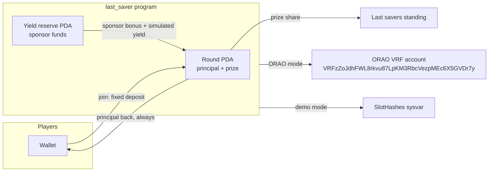

# Last Saver Standing

A no-loss Solana savings game. Everyone deposits the same amount into a round vault. Random check-in windows open. Miss one and you are out of the prize — your deposit still comes back. The last savers standing split a prize that is **not** taken from anyone's principal.

Built for the MLH Solana Hackathon, 6–8 November 2026. Devnet and local validator only.

## Pitch

Savings apps ask you to stay consistent. This one makes that the game. A round is a short battle royale inside a shared vault:

- Join by locking a fixed deposit.
- Survive randomly timed check-in windows.
- Spend a single **shield** to forgive one miss, or a single **jolt** to force a rival into one extra check-in.
- When the round ends, every deposit is withdrawable. Survivors also split the prize.

The prize is a sponsor bonus plus a published simulated APY on the pooled deposits. Both are paid from a separate reserve. The vault's accounting rejects any transfer that would dip into principal.

## How a round works

1. Someone initializes the arena once. That records the yield source as a mock reserve and the APY (default 5%).
2. Anyone can fund the reserve. That SOL is sponsor money, not a player deposit.
3. A host creates a round: entry amount, sponsor bonus, window length, gap range, and randomness mode.
4. Players join. The program transfers the entry into the round account and remembers it as principal.
5. The host starts the round. The sponsor bonus moves from the reserve into the prize bucket.
6. For each window, a crank commits a 32-byte seed, then reveals randomness:
   - **ORAO VRF** (devnet): the seed is committed only while the ORAO request account is still pending, so the crank cannot grind a known result. The fulfilled 64 bytes pick the gap.
   - **Demo slot hash**: the seed is mixed with the hash of the commit slot, which does not exist yet at commit time. This is commit-reveal, **not a VRF**. The account stores the mode so clients can say so.
7. The gap is `min_gap + (first 8 bytes as u64) % (max_gap - min_gap + 1)` seconds. The window then stays open for `window_duration`.
8. Required players check in. A shield can be armed beforehand; it is consumed only if you miss. Checking in keeps the charge.
9. A jolt, during a standard window, gives one rival one extra personal check-in after this window. Same duration. One jolt per player, one pending jolt per target. It does not move SOL.
10. After the window closes, anyone can resolve absences and finalize. The last standard window, or a round with one player left, settles.
11. Settlement quotes simulated yield for the seconds the principal was locked and pulls **at most** what the reserve can pay. Survivors split the prize. Remainder dust can be swept back to the reserve.
12. Anyone can crank `withdraw_principal` for any player, back to that player's wallet. Eliminated or not.

If a window cannot be opened (oracle stall, nobody cranking) past `progress_deadline`, anyone can refund the round. Prize money returns to the reserve. Deposits remain withdrawable.

## Architecture



One Anchor program, `last_saver`. Rounds and players are PDAs. The round account is the vault: lamports above rent are principal + prize + rounding dust, and every instruction that moves SOL checks that invariant before it succeeds.

The yield path is a single function, `accrue`. Today it computes

```text
principal * annual_bps * seconds / (10_000 * 31_536_000)
```

and transfers that from the reserve. A later lending or staking adapter would replace that function and still leave principal untouched. Rounds snapshot the rate and the source tag (`1` = mock reserve) at start, so an admin change does not rewrite a live round.

## Randomness

ORAO VRF classic is on devnet and mainnet at the same program id, `VRFzZoJdhFWL8rkvu87LpKM3RbcVezpMEc6X5GVDr7y` (crate `orao-solana-vrf` 0.8.x, updated November 2026). This build uses the classic account, not the callback program.

- Request PDA: `["orao-vrf-randomness-request", seed]`.
- The client submits ORAO `request_v2` and `commit_window_orao` in one transaction. Commit refuses a request that is already fulfilled.
- Reveal reads the fulfilled `RandomnessV2` account, checks the owner, the PDA, the seed, and the 64-byte value.

Demo mode is what the two-minute video and the program-test suite use, because it does not wait on the oracle. It is labelled `DemoSlot` on the account and in the UI. Slot leaders can bias future hashes. Do not use it for a prize you care about.

Switchboard On-Demand also exists on devnet (`Aio4gaXjXzJNVLtzwtNVmSqGKpANtXhybbkhtAC94ji2`). ORAO was chosen because the program id is shared with mainnet, the account layout is stable, and a round can verify it with a read instead of a quote-verification CPI.

## No-loss

- Join stores `entry_lamports` and adds that exact amount to `principal_lamports`.
- Prize credits only come from the reserve (sponsor bonus at start, simulated yield at settle).
- Withdrawals pay `entry_lamports` back to the player wallet and subtract it from principal.
- `assert_backing` reverts if the round's lamports would fall below rent + principal + prize + dust.
- Tests warp one year at 5% and expect exactly 0.15 SOL of yield on 3 SOL of principal, paid by the reserve. A second test funds the reserve with only the sponsor bonus and checks that yield stays 0 while both deposits still return in full.
- Cancel and stall-refund return the prize to the reserve and still allow principal withdrawals.

There is no admin instruction that withdraws principal.

## Program id

```text
52MzPzQgqVGXYZNRAbF1nivLSUh7NQgYAbhEoFE7NUyb
```

Devnet only. The program keypair is not in git (`target/deploy/` is ignored). The upgrade authority is the deployer's local Solana wallet and is also not committed.

**Deployment status:** the SBF v2 binary builds, and the full turbo demo completes on a local `solana-test-validator`. A devnet deploy was not finished here: `solana airdrop` against `https://api.devnet.solana.com` returned rate-limit errors, so there was no SOL to pay rent. Run `scripts/devnet-deploy.sh` from a wallet that already has devnet SOL. Do not treat the program id as live on devnet until that command prints `Deployed`.

## Run the tests

Host toolchain: Rust 1.99 (see `rust-toolchain.toml`), Solana CLI 2.1.21, Anchor CLI 0.31.1. Tests run the program in-process with `solana-program-test`. They do not need a validator.

```bash
cargo test -p last_saver -- --test-threads=1
```

Covered: join, duplicate join, early start rejected, demo windows driven by a real slot hash, shield saved on check-in and consumed on a miss, elimination, jolt bounds, jolt elimination, one-year mock yield paid from the reserve, empty-reserve yield of zero, principal withdraw exact to the lamport, claim refused for eliminated players, double withdraw refused, ORAO commit rejected when the result is already known, ORAO reveal gap matches the fulfilled bytes, cancel, and stall refund.

## Frontend

```bash
cd app
npm install
npm run dev
```

Open http://127.0.0.1:5173. Default cluster is devnet (`https://api.devnet.solana.com`). For a local validator:

```bash
VITE_SOLANA_RPC=http://127.0.0.1:8899 VITE_SOLANA_CLUSTER=localnet npm run dev
```

Connect Phantom or Solflare, or use **Practice key** plus **Airdrop 2 SOL**. Fund the reserve, create a turbo round (15 second windows), join from a second wallet, start, draw the window, check in.

The UI recomputes the gap from the stored randomness and shows whether it matches. Demo rounds say they are not VRF. The prize card separates sponsor bonus from mock yield.

## Two-minute demo

```bash
cargo build-sbf --arch v2 -- -p last_saver
chmod +x scripts/demo-local.sh
./scripts/demo-local.sh
```

`cargo build-sbf` here is the Agave 4.4+ binary (platform-tools v1.57, `--arch v2`). Anchor 0.31's older platform-tools cannot read this lockfile, and a v3 ELF does not execute on the Agave 2.1 test validator.

That boots `solana-test-validator` with the program loaded and runs `app/scripts/turbo-demo.ts`:

- Three fresh keypairs, 0.05 SOL each, 0.05 SOL sponsor prize.
- 8 second windows, 4 second gap, demo slot-hash randomness.
- Alice checks in. Bob burns his shield by missing. Cara is eliminated.
- Alice jolts Bob. Both survive the second window. Bob misses the extra window and drops.
- Alice claims the prize. A separate crank pays fees so all three wallets increase by exactly 0.05 SOL of principal. Mock yield on a one-minute round is 0 lamports, which the script prints. The 0.05 SOL prize is the sponsor bonus.

Against an already running validator:

```bash
cd app && RPC=http://127.0.0.1:8899 npm run demo
```

## Deploy to devnet

```bash
sh -c "$(curl -sSfL https://release.anza.xyz/v2.1.21/install)"
# Anchor 0.31.1 binary, or: avm install 0.31.1
solana config set --url devnet
chmod +x scripts/devnet-deploy.sh
./scripts/devnet-deploy.sh
```

The script refuses a mainnet RPC. Devnet airdrops are often rate limited; if the balance stays 0, fund the wallet from https://faucet.solana.com and rerun the `solana program deploy` line the script prints via its failure. Do not point this at mainnet and do not use real funds.

## Honest limitations

- Unaudited. A hackathon program, not a place to put money you cannot lose.
- Devnet and local validator only. No mainnet code path was exercised, and the deploy script bails if the RPC looks like mainnet.
- The visible prize on a short round is a sponsor bonus. The 5% figure is a simulated quote paid from that same reserve, not yield from lending or staking. The UI and the on-chain `yield_source` tag say so.
- Demo slot-hash mode is commit-reveal. It is not ORAO and not safe against a malicious slot leader.
- ORAO fulfillment depends on the devnet oracle. If it stalls, `refund_stalled` returns the prize to the reserve after the timeout so deposits are not stuck.
- Native SOL only. An SPL entry would be a second vault, behind the same principal accounting.
- Max 16 players. Windows need a crank; the UI and the demo script are that crank.
- The upgrade authority key is not published. The deployed program cannot be upgraded from this repo alone.
- Integer yield rounds down. A few minutes on a small deposit is often 0 lamports, which is the honest result.

## Layout

```text
programs/last_saver/   Anchor program and program-test suite
app/                   Vite + React wallet UI and turbo-demo.ts
scripts/demo-local.sh  local validator + demo
scripts/devnet-deploy.sh
```
